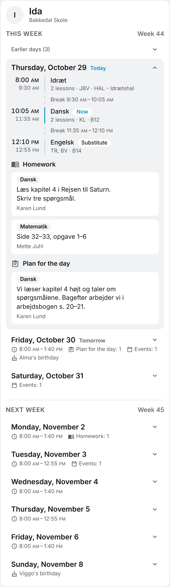
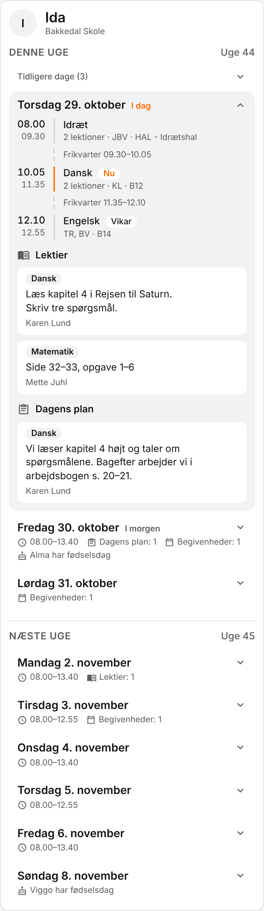

# Aula Connect Card

A Home Assistant dashboard card with each child's week from
[Aula Connect](https://github.com/HairingX/ha_aula_connect): the timetable, homework and the
teacher's plan for the day from the school's week plan, other calendar events, and birthdays -
for this week and next, day by day, with today opened.


| Dark theme                                            | In English, with 12-hour times                             | A theme with an orange primary colour                      |
| ----------------------------------------------------- | ---------------------------------------------------------- | ---------------------------------------------------------- |
|  |  |  |


The screenshots show made-up data.

## What it shows

For each child, under the child's first name and school:

- **The days of this week and next**, Monday to Sunday as Aula's weeks are, with today opened
  and marked. The days before today are folded into one row, _Tidligere dage_ (earlier days),
  that opens to show them. A Saturday or Sunday with nothing on it is left out; a weekday with
  nothing on it is shown, as it may be a holiday. On a Saturday or Sunday with nothing on it, the
  Monday after is opened instead. A closed day sums itself up: the school hours, the number of
  notes in each section, the events and the birthdays. On a wide screen the two weeks stand side
  by side while this week has days to come.
- **The timetable**: each lesson's time, subject, teachers (by their initials) and room, with
  the lesson going on now marked, and a lesson that is not as planned - with a substitute, say -
  labelled. Back-to-back lessons that are the same - subject, teachers, room and state, the
  second beginning at most 10 minutes after the first ends - are shown as one, with the number
  of lessons. A gap of 20 minutes or more between lessons is shown as a break.
- **Homework and the plan for the day** from the week plan, on the day they are for, sorted
  into sections - by default _Lektier_ (homework, Aula's notes of type `task`) and _Dagens plan_
  (today's plan, its notes of type `comment`) - each with its subject.
- **Events**, all-day ones on each day they cover, and **birthdays**.

Notes and birthdays come from the school's week plan. Where the school has none, the card leaves
them out rather than say there is no homework.

The card is in Danish when Home Assistant is, and in English otherwise, and follows the user's
time format and time zone. Its colours are the theme's: the primary colour marks only today and
the lesson going on now.

## Installation

You need [Aula Connect](https://github.com/HairingX/ha_aula_connect) 0.0.4 or later set up: the
card reads the websocket API that release added.

Through HACS:

1. In HACS, open the menu, choose **Custom repositories**, and add
   `https://github.com/HairingX/ha_aula_connect_card` with the type **Dashboard**.
2. Find **Aula Connect Card** in HACS and download it. HACS adds the dashboard resource.
3. Reload the browser, edit a dashboard, add a card, and choose **Aula Connect**.

## Configuration

Everything can be set in the card's visual editor. In YAML:

```yaml
type: custom:aula-connect-card
children: [1001] # the child ids to show; every child when left out
weeks: 2 # 1 for this week, 2 for this and next week (the default)
show: # every part is shown unless switched off
  timetable: true
  tasks: true
  events: true
  birthdays: true
sections: # how the week plan's notes are sorted; left out, the defaults below apply
  - title: Lektier
    icon: mdi:book-open-variant
    type: task
  - title: Dagens plan
    icon: mdi:clipboard-text-outline
    type: comment
```

| Option     | Default              | Meaning                                                      |
| ---------- | -------------------- | ------------------------------------------------------------ |
| `children` | every child          | The children to show, by Aula's child id.                    |
| `weeks`    | `2`                  | `1` shows this week, `2` this week and next.                 |
| `show`     | all `true`           | `timetable`, `tasks`, `events` and `birthdays`, each on/off. |
| `sections` | Lektier, Dagens plan | The sections of the week plan's notes, in order.             |

A section has a `title`, an optional mdi `icon`, and rules: `type` (the note's type, such as
`task` for an assignment or `comment` for information), `subject` (the note's subject) and
`text` (a text the note's title contains). A note goes in the first section whose rules all
hold - a section without rules takes every note - and a note no section takes goes in _Andet_
(Other) at the end. The defaults follow Home Assistant's language; a card added from the card
picker leaves `sections` out, so that it keeps to them.

## The API it uses

- `aula_connect/children`, to list the children.
- `aula_connect/week/subscribe`, with a child's `entry_id` and `child_id` and the days from the
  Monday of this week to the end of the last week shown. The integration sends the range again
  whenever it can have changed; the card moves to a new day and week by itself.

## Privacy

The card only shows. It never changes anything in Aula and marks nothing as read. It reads
what Aula Connect has already fetched, through Home Assistant's own connection, and sends
nothing anywhere else.

## Development

Node 22: `npm ci`, then `npm run lint`, `npm run typecheck`, `npm test` and `npm run build`,
which writes `dist/aula-connect-card.js`. `CARD_VERSION` sets the version the build embeds.

## License

MIT.
