# Aula Connect Cards

Three Home Assistant dashboard cards for the Danish school platform Aula, from the
[Aula Connect](https://github.com/HairingX/ha_aula_connect) integration: **the school day** that
matters now, **the week plan** for the days ahead, and **the week** day by day. They are made to be
read on a phone in the evening and on a wall screen in the morning, in Danish or English, and
they only show: nothing in them changes anything in Aula.

| School day, on a phone in the evening                                             | The wall screen, two children                                                                 |
| --------------------------------------------------------------------------------- | --------------------------------------------------------------------------------------------- |
| 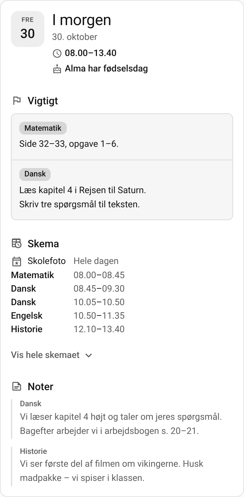 | 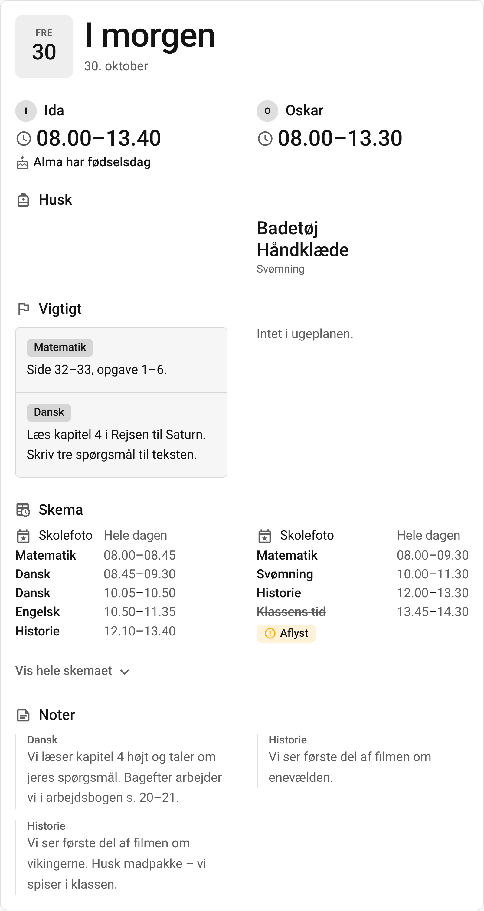 |

| Week plan                                                                  | Week                                                              |
| -------------------------------------------------------------------------- | ----------------------------------------------------------------- |
| 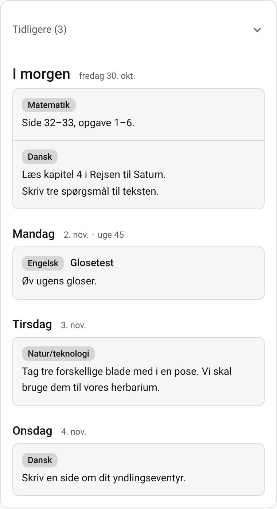 | 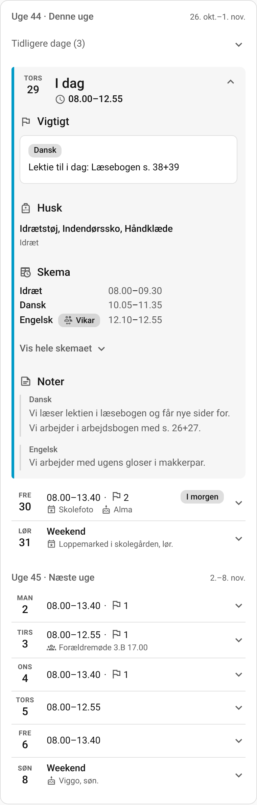 |

| During school, in a dark theme                                                        | In English, 12-hour times, an orange primary                                           | The wall in the morning                                                                 |
| ------------------------------------------------------------------------------------- | -------------------------------------------------------------------------------------- | --------------------------------------------------------------------------------------- |
| 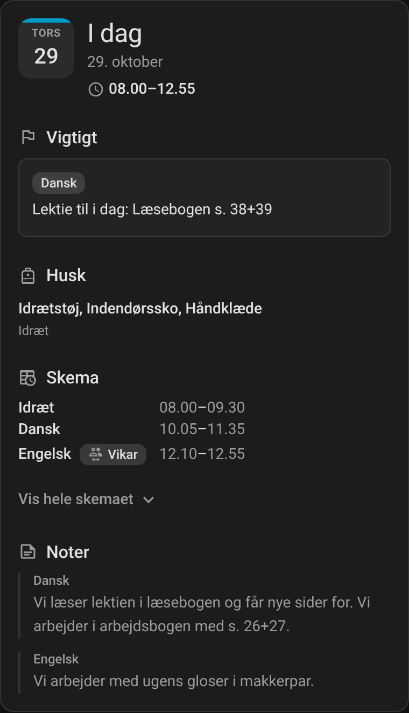 | 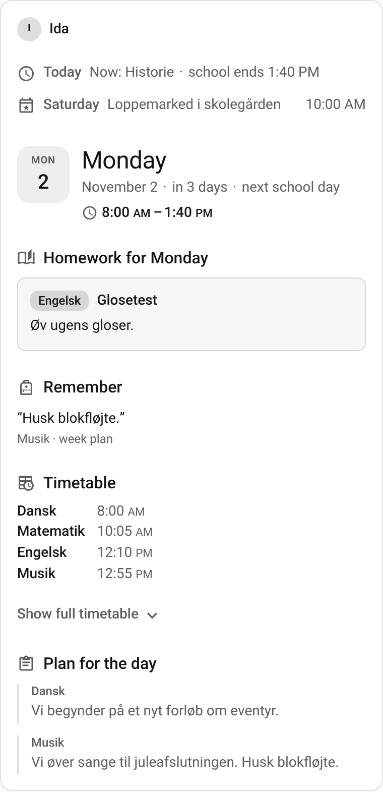 | 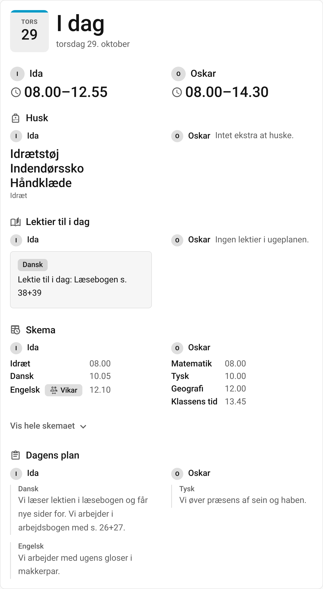 |

The screenshots show made-up data; no real child, school or teacher.

## Installation

You need [Aula Connect](https://github.com/HairingX/ha_aula_connect) **0.0.4 or later** set up:
the cards read the websocket API that release added.

Through HACS:

1. In HACS, open the menu, choose **Custom repositories**, and add
   `https://github.com/HairingX/ha_aula_connect_card` with the type **Dashboard**.
2. Find **Aula Connect Card** in HACS and download it. HACS adds the dashboard resource; the one
   download holds all three cards.
3. Reload the browser, edit a dashboard, add a card, and choose **Aula Connect · Skoledag**,
   **Aula Connect · Ugeplan** or **Aula Connect · Uge** (in English: School day, Week plan, Week).

Every option can be set in each card's visual editor, or in YAML as below.

## The day the cards show

The cards look at **the school day that matters now**, for each child:

- **Until noon** it is today, when today is a school day.
- **From noon** it is the next school day, as what matters then is tomorrow's homework and bag.
  On a Friday afternoon, a Saturday and a Sunday that is Monday; before a holiday, the first day
  after it.
- The header says which day it is, so that it is never taken for today: **I dag** or
  **I morgen** with the date, or the weekday with its date and "næste skoledag". Today's date tile has a bar in the theme's
  colour.
- A school day is a day with lessons. A weekday without lessons counts when the week plan has a
  note for it or the school an event, as a camp or a trip has; a holiday or a weekend without
  lessons never does. Where a school keeps no timetable in Aula, every weekday is a school day.
- `switch_time` moves noon: `switch_time: "15:00"` keeps today until three, and `"00:00"` keeps
  today all day.

While someone touches the card, the day it shows stays put for a minute. What was opened closes
again when the day moves on, and after ten minutes without a touch, so that a shared screen is
always as it should be.

## School day card

`type: custom:aula-connect-day-card` - the day that matters now, for the phone and the wall.

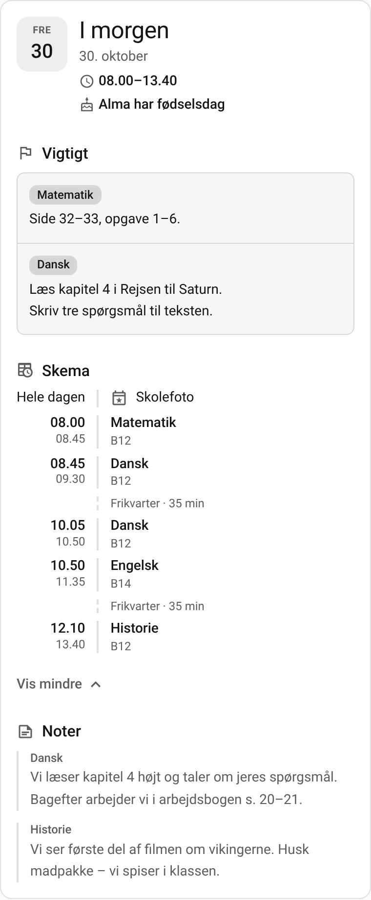

- **Above the header**, after noon: what is left of today ("I dag · fri kl. 13.40", with several
  children each child's end), and the days passed over when they are not just a weekend: a
  Saturday's flea market, a holiday with its dates, a weekday with no timetable.
- **The header**: the day, its date, and under it the school hours on a line of their own; then
  the day's birthdays as one line: "Alma, Bo og Carl har fødselsdag". Before a holiday it names
  the holiday, its dates and the day school starts again.
- **The blocks**, in this order unless you choose another:
  - **Vigtigt** (important): what the week plan marks as a task for that day - homework, a test,
    a thing to do - every one in full: it is never folded.
  - **Husk** (remember): the things to bring for the day's subjects, from your own
    [packing rules](#things-to-bring).
  - **Skema** (timetable), as a calendar shows a day: the events lasting the whole day first,
    marked "Hele dagen", then the lessons and the events with a time in the order they begin,
    each event with its icon and its place under it. Folded, a lesson is a line with its start
    and end - "Dansk 08.45–09.30" - and lessons of one subject with no break between them are
    one line, so the breaks show; a substitute or a cancelled lesson has a line of its own. The
    timetable is never cut short: "Vis hele skemaet" adds rooms, teachers, breaks and the lesson
    going on now.
  - **Noter** (notes): the week plan's other notes for the day, in a quieter column; each folds
    after six lines with its own "Vis mere", as a teacher may write fifty.

A block with nothing in it for any child is left out, or says so once.

## Week plan card

`type: custom:aula-connect-weekplan-card` - the week plan ahead, by the day it is for.

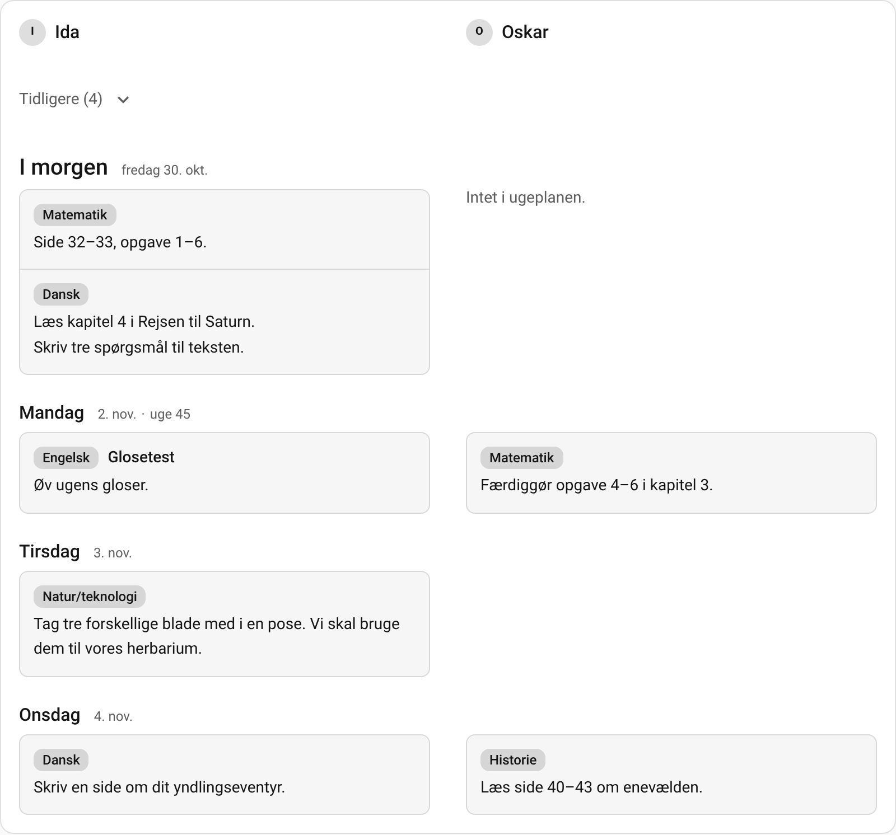

It reads from top to bottom in date order: the days before folded into "Tidligere" at the top,
then the day that matters now and every later day with something in the week plan this week and
next. A week whose plan is not in Aula yet says so. On a wide card one child's days stand in two
columns, and several children each have a column, named once at the top.

`notes` chooses what it shows of the week plan:

- `tasks`, the default: what the plan marks as a task, in boxes, as in **Vigtigt**.
- `comments`: the plan's other notes, as in **Noter**.
- `all`: both, the tasks in boxes and the notes in a quieter column under them.

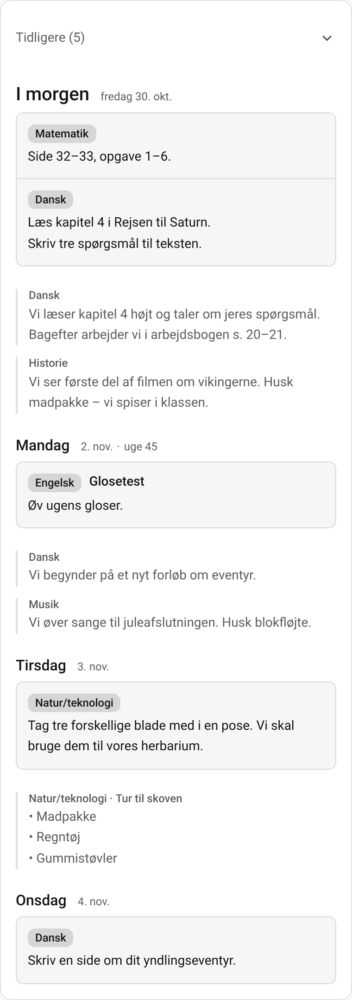

## Week card

`type: custom:aula-connect-week-card` - the week day by day, for planning.

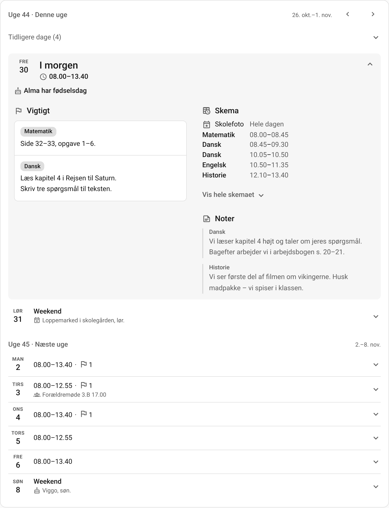

This week and next, a row a day: the day that matters now opened, with its blocks as on the
school day card and the teachers' initials in the timetable; the days before it folded into one
row; the rest closed, each summed up in a line: the hours, a flag with how many things the
plan marks as important ("08.00–13.40 · ⚑ 2"), and an event and a birthday, or "2 begivenheder"
and "3 fødselsdage" when there are more. A weekend with something on is one
row, and a holiday's days are one row with its dates. From Friday afternoon this week collapses
and next week opens at Monday:

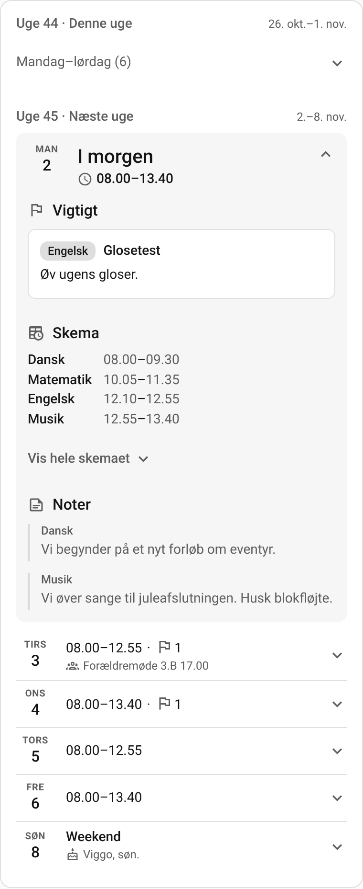

**‹ and ›** step a week back or ahead, as far as you like: to see what last week's plan said, or
what is on in three weeks. A week back shows every day as a row of its own. **I dag** brings the
card back, and it comes back by itself after ten minutes without a touch, so a shared screen is
always on this week. With one child the steps sit beside the first week's name; with several,
above the children.

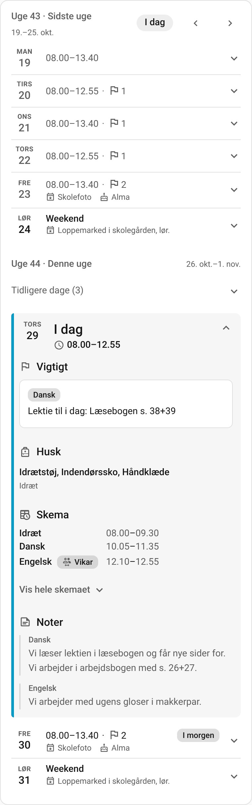

## Configuration

| Option                 | Cards            | Default          | What it does                                                                                                                                                                     |
| ---------------------- | ---------------- | ---------------- | -------------------------------------------------------------------------------------------------------------------------------------------------------------------------------- |
| `children`             | all              | every child      | The children to show, by Aula's child id, in this order.                                                                                                                         |
| `switch_time`          | all              | `"12:00"`        | When the next school day takes over from today. `"00:00"` keeps today all day.                                                                                                   |
| `size`                 | all              | `normal`         | `large` for a wall screen: text 1.5 times as large, the wall's sizes from a 480 px card, and Husk first.                                                                         |
| `subject_names`        | all              | none             | [Names](#subject-names) for lesson titles, over the built-in ones.                                                                                                               |
| `expand_abbreviations` | all              | `true`           | `false` shows the subjects' abbreviations as Aula has them, in place of the [built-in names](#subject-names).                                                                    |
| `info_lines`           | all              | `6`              | The lines of a note shown before "Vis mere", 0 to 50; `0` shows every note whole.                                                                                                |
| `notes`                | week plan        | `tasks`          | `tasks`, `comments` or `all`: what the card shows of the week plan.                                                                                                              |
| `order`                | school day, week | none             | The blocks to put first, in this order: `task`, `pack`, `timetable`, `comment`. The rest follow the standard order: Vigtigt, Husk, Skema, Noter; with `size: large`, Husk first. |
| `show`                 | school day, week | everything shown | Hide a block with `false`: `task`, `pack`, `timetable`, `comment`; `events: false` leaves out the events, `birthdays: false` the birthdays.                                      |
| `timetable`            | school day, week | `compact`        | `compact` folds the timetable to a line per lesson; `full` opens it whole, still to be folded.                                                                                   |
| `packing`              | school day, week | none             | [Things to bring](#things-to-bring) when a subject is on the timetable.                                                                                                          |
| `weeks`                | week             | `2`              | `1` shows the week of the day that matters now, `2` this week and next.                                                                                                          |

A school day card in YAML, every option at its default but the children:

```yaml
type: custom:aula-connect-day-card
children: [1001]
switch_time: "12:00"
size: normal
order: [] # task, pack, timetable, comment; those named come first
show:
  task: true
  pack: true
  timetable: true
  comment: true
  events: true
  birthdays: true
timetable: compact
info_lines: 6
packing: []
expand_abbreviations: true
subject_names: []
```

A week plan card, showing the notes too:

```yaml
type: custom:aula-connect-weekplan-card
children: [1001]
notes: all
```

The child ids are the integration's; the card's editor lists the children by name.

### Things to bring

**Husk** shows your own **packing rules**: what to bring when a subject is on the day's
timetable. Nothing is read from the week plan's text. A rule matches the subject by any of its
names, so `Idræt` matches lessons Aula calls `IDR` or `3.B IDR`:

```yaml
packing:
  - subject: Idræt
    items: [Idrætstøj, Indendørssko, Håndklæde]
  - subject: Svømning
    items: Badetøj
```

While the timetable is hidden, Husk also names the day's subjects: "Fag: Dansk, Matematik,
Engelsk, Musik".

### Subject names

Aula's timetable often has abbreviations where the week plan has names. The cards write the
common ones out - `DAN` Dansk, `MAT` Matematik, `IDR` Idræt, `N/T` Natur/teknologi, `UUV`
Understøttende undervisning, `BHK` Børnehaveklasse, and more - and compare subjects by them.
Correct or add names, or keep an abbreviation as it is by naming it itself; at a dance school,
`DAN` is Dans:

Prefer the abbreviations? `expand_abbreviations: false` shows every subject as Aula writes it

- "IDR", "DAN" - and keeps the names you give. The cards still know that `IDR` is Idræt, so a
  packing rule for `Idræt` still matches.

```yaml
subject_names:
  - aula: DAN
    name: Dans
  - aula: UUV
    name: Bevægelse
  - aula: KRI
    name: KRI
```

## Several children

**One card with several children** answers each question for all of them at once: one header
when they have the same day, a column of hours and things of each child's own under it, and in
every block a part for each child, in the same order and the same column all the way down, the
children named once over the columns. With one child, no name is shown. From about 600 px (700 px on a wall) two children stand side by
side, from about 900 px (1100 px) three; more fill two rows. The week card, whose rows need more
room, puts two side by side from about 750 px (900 px on a wall) and three from about 1150 px
(1550 px). In a sections view a card is as wide as its section: let the section span the view's
columns (`column_span`) for the children to stand side by side.

**One card per child** shows them one after another: put a card for each child, each with its
own `children`.

## The wall screen

For a tablet on the wall, a sections view with three columns and the school day card spanning two
of them, `size: large`; the week plan card beside it:

```yaml
type: sections
max_columns: 3
sections:
  - type: grid
    column_span: 2
    cards:
      - type: custom:aula-connect-day-card
        size: large
  - type: grid
    cards:
      - type: custom:aula-connect-weekplan-card
```

With `size: large` the header's title is 56 px, each child's hours 36 px and the things to bring
30 px, read from across a kitchen, and Husk comes first. The first screen of a 1280 × 800 tablet
holds the day, each child's hours and what each child is to bring.

## The API it uses

- `aula_connect/children`, to list the children.
- `aula_connect/week/subscribe`, with a child's `entry_id` and `child_id` and the days from the
  Monday of this week to the Sunday of the next; browsed to other weeks, the week card subscribes
  for those days too, for as long as it shows them and a minute after. The integration sends the range again whenever
  it can have changed; the cards move to a new day and week by their own clock.

## Privacy

The cards only show. They never change anything in Aula, mark nothing as read and have nothing
to tap but what opens and closes. They read what Aula Connect has already fetched, through Home
Assistant's own connection, and send nothing anywhere else.

## Development

Node 22: `npm ci`, then `npm run lint`, `npm run typecheck`, `npm test` and `npm run build`,
which writes `dist/aula-connect-card.js` and fails above the bundle's budget. `CARD_VERSION` sets
the version the build embeds. The screenshots come from `node scripts/screenshot.ts` after a
build (Playwright with Chromium, installed outside the repository); `--set docs` writes these.

## License

MIT.
